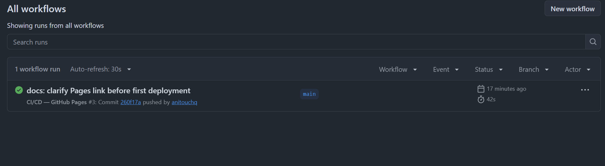
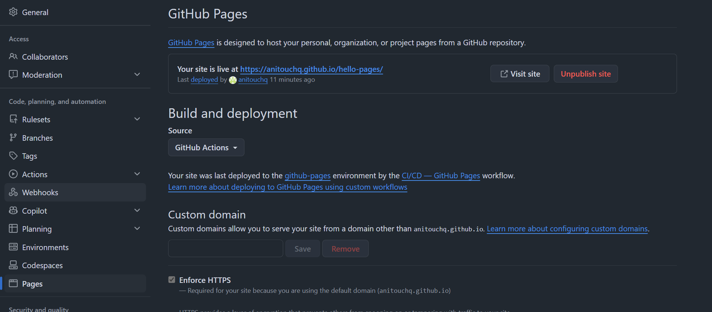

# hello-pages

[](https://github.com/anitouchq/hello-pages/actions)


Небольшой сайт о спокойном планировании на React 18 и Vite. GitHub Actions устанавливает зависимости, проверяет проект, собирает production-версию и публикует каталог `dist/` на GitHub Pages.

## 📸 Скриншоты

### 1. Открытый сайт на GitHub Pages


### 2. GitHub Actions — успешный деплой



### 3. Настройки Pages (Source: GitHub Actions)



## Сайт

[Открыть сайт на GitHub Pages](https://anitouchq.github.io/hello-pages/)

## Установка и запуск

Требуется Node.js и npm:

```bash
npm ci
npm run dev
```

Production-сборка:

```bash
npm run ci
```

## Как работает pipeline

1. Push в `main` и pull request запускают CI.
2. Устанавливаются зависимости из `package-lock.json` через `npm ci`.
3. Выполняются проверки и production-сборка.
4. Каталог `dist/` сохраняется как Actions artifact.
5. После успешного CI при push в `main` отдельный job публикует сайт на GitHub Pages.

В `vite.config.js` задан базовый путь `/hello-pages/`, необходимый для публикации проекта в подпапке GitHub Pages.

## Структура проекта

| Файл или каталог | Назначение |
|---|---|
| `.github/workflows/ci-cd.yml` | CI-проверки, сборка и деплой на GitHub Pages |
| `src/App.jsx` | Основной React-компонент сайта |
| `src/main.jsx` | Точка входа React-приложения |
| `src/index.css` | Глобальные стили |
| `index.html` | HTML-шаблон приложения |
| `vite.config.js` | Настройки Vite и базовый путь публикации |
| `package.json` | Команды проекта и зависимости |
| `package-lock.json` | Зафиксированные версии npm-зависимостей |
| `eslint.config.js` | Правила ESLint |
| `.htmlvalidate.json` | Настройки проверки HTML |
| `.stylelintrc.json` | Правила Stylelint |
| `screenshots/` | Скриншоты сайта, Actions и настроек Pages |

## Результаты

- [GitHub Actions](https://github.com/anitouchq/hello-pages/actions)
- [Настройки GitHub Pages](https://github.com/anitouchq/hello-pages/settings/pages)

[Главный каталог CI/CD проектов](https://github.com/anitouchq/CI-CD-Pipelines)
